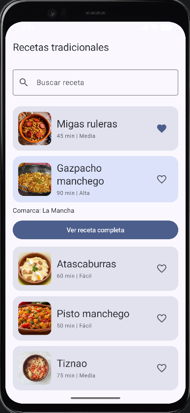
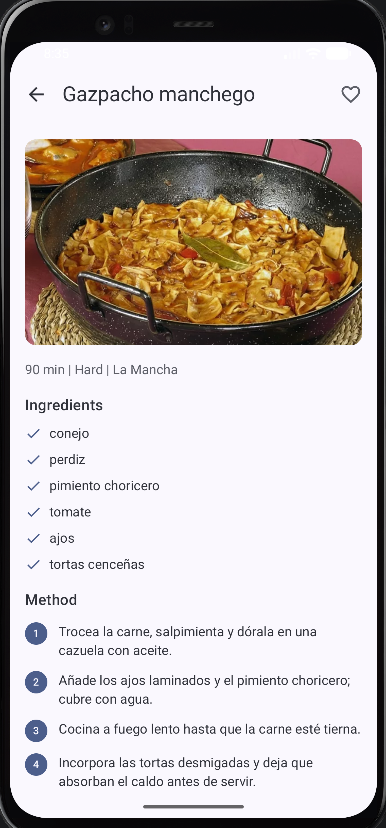
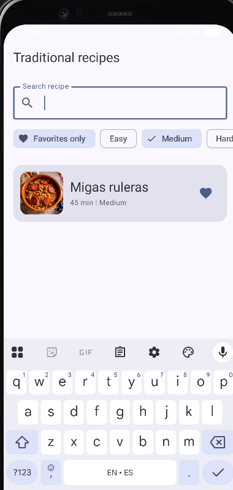
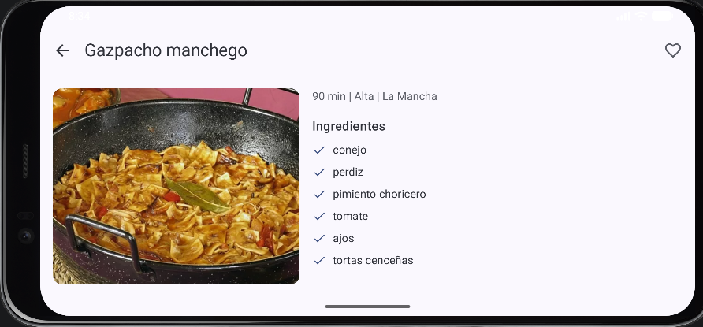

# Recetario Manchego

Aplicación Android desarrollada en **Kotlin** y **Jetpack Compose** (Material Design 3) como proyecto de la UT2. Permite explorar recetas tradicionales de Castilla-La Mancha, marcar favoritas, filtrar por nombre y consultar la ficha completa de cada plato con diseño adaptable a la orientación del dispositivo.

## Funcionalidades principales

* **Lista de recetas interactiva:** Muestra 10 platos tradicionales manchegos. Al pulsar una tarjeta se despliega con animación mostrando su comarca y el acceso a la ficha completa (solo una abierta a la vez).
* **Ficha adaptativa:** Muestra foto, tiempo, dificultad, comarca, ingredientes y pasos numerados. Adapta su diseño automáticamente:
  * *Vertical:* imagen arriba y contenido debajo.
  * *Horizontal:* imagen a la izquierda (40 %) y contenido a la derecha (60 %).
* **Recetas favoritas (Mejora 1):** Icono de corazón animado tanto en cada tarjeta como en la barra superior de la ficha, sincronizado en tiempo real y persistente ante giros de pantalla.
* **Buscador por nombre (Mejora 2):** Filtro en tiempo real que no distingue mayúsculas de minúsculas, con botón para limpiar el texto y conservación del filtro al girar o volver de una ficha.
* **Multiidioma y tema adaptable:** Interfaz traducida al español (por defecto) e inglés (`values-en`), compatible con modo claro y oscuro mediante `MaterialTheme.colorScheme`.
* **Filtros combinados (Mejora 3):** Barra horizontal de `FilterChip` debajo del buscador que permite filtrar por *"Solo favoritas"* y por nivel de dificultad (*Fácil*, *Media*, *Alta*) acumulándose con el texto buscado, además de un botón rápido para limpiar los filtros si no hay coincidencias.

## Arquitectura y estructura del proyecto

La app sigue el patrón **MVVM con Flujo Unidireccional de Datos (UDF)**: `RecetasViewModel` gestiona el estado con `StateFlow` y sobrevive a los cambios de configuración, mientras que las pantallas observan los cambios y los bloques visuales son componentes sin estado (*stateless*).

com.example.recetariomanchego/
├── data/
│   ├── Receta.kt              # Modelo inmutable y enum de dificultad
│   └── RecetasData.kt         # Listado inicial de 10 recetas manchegas
├── ui/
│   ├── RecetasViewModel.kt    # Estado compartido (recetas, favoritas, tarjeta expandida)
│   ├── ComponentesReceta.kt   # Bloques reutilizables (foto, resumen, ingredientes, pasos, tarjeta, corazón y barra de filtros)
│   ├── PantallasReceta.kt     # ListaRecetasScreen (con buscador) y FichaRecetaScreen (adaptativa)
│   └── theme/                 # Tema, colores y tipografías de Material 3
└── MainActivity.kt            # Punto de entrada y navegación con NavHost

# Registro de Pruebas

## 1. Pruebas realizadas en el emulador

| # | Prueba realizada | Resultado esperado | Estado | Indicador |
|---|---|---|---|---|
| 1 | Pulsar una tarjeta en la lista | La tarjeta cambia de color con animación (`animateColorAsState`) y despliega suavemente (`AnimatedVisibility`) la comarca y el botón *"Ver receta completa"*. | Correcto | 3.f.1, 3.f.2 |
| 2 | Pulsar otra tarjeta estando una abierta | La primera tarjeta se cierra y se abre solo la nueva. | Correcto | 2.g.1 |
| 3 | Pulsar el botón *"Ver receta completa"* | Abre `FichaRecetaScreen` mostrando los datos de esa receta. | Correcto | 2.g.1 |
| 4 | Pulsar la flecha de volver (o gesto atrás) en la ficha | Vuelve a la lista y la tarjeta que habíamos abierto sigue desplegada. | Correcto | 2.g.1 |
| 5 | Girar el móvil (`Ctrl + F11`) en la lista con una tarjeta abierta | La tarjeta sigue abierta después de girar la pantalla. | Correcto | 2.g.2, 1.h.2 |
| 6 | Abrir la receta 7 y girar el móvil (`Ctrl + F11`) | Sigue mostrando la receta 7 y cambia al diseño horizontal (40 % foto a la izquierda / 60 % datos a la derecha). | Correcto | 2.g.2, 2.g.3 |
| 7 | Cambiar el idioma del emulador a inglés (*English*) | Todos los textos de la interfaz (títulos, botones, buscador, dificultades y accesibilidad) salen en inglés; las recetas siguen en español. | Correcto | 2.b.5, 1.h.2 |
| 8 | Activar el modo oscuro (*Dark theme*) del emulador | Toda la app se adapta usando `MaterialTheme.colorScheme` sin textos ni iconos que no se lean bien. | Correcto | 2.b.4 |
| 9 | Pulsar el corazón de favorita en la tarjeta y en la barra superior de la ficha | Cambia de icono y de color animado sin abrir ni cerrar la tarjeta, se sincroniza entre lista y ficha y aguanta al girar. | Correcto | Mejora 1 |
| 10 | Escribir `"mig"` o `"MIG"` en el buscador y pulsar el botón `X` | Filtra sin importar mayúsculas dejando solo *"Migas ruleras"*, mantiene el texto al girar y el botón `X` borra la búsqueda. | Correcto | Mejora 2 |
| 11 | Activar el chip *"Solo favoritas"* junto con una dificultad (ej. *Media*) y escribir en el buscador | Filtra acumulando las tres condiciones a la vez; si no hay coincidencias, muestra el aviso y el botón *"Limpiar filtros"* reinicia todo. | Correcto | Mejora 3 |

---

## 2. Qué pasa con el buscador al abrir una ficha y volver

Si escribimos algo en el buscador, entramos a ver una receta y luego volvemos atrás, **el texto que habíamos escrito sigue ahí y la lista sigue filtrada**. Esto pasa porque `NavHost` mantiene la pantalla `"lista"` guardada en su historial de navegación mientras estamos viendo `"ficha/{id}"`, así que no pierde lo que tenía guardado en `rememberSaveable`.

---

## 3. Incidencias encontradas durante el desarrollo y cómo se solucionaron

1. **Fallos de referencias entre archivos (`Unresolved reference 'RecetasViewModel'`):**
   * *Qué pasó:* Al crear `RecetasViewModel.kt`, `ComponentesReceta.kt` y `PantallasReceta.kt`, se crearon dentro de la carpeta `ui.theme` en vez de `ui`.
   * *Cómo se arregló:* Cambié el `package` de la primera línea a `com.example.recetariomanchego.ui` y moví los tres archivos a la carpeta `ui` usando *Refactor > Move* (`F6`).
2. **Error al compilar por versión de Android (`checkDebugAarMetadata`):**
   * *Qué pasó:* Las librerías de `lifecycle` y `core-ktx` pedían compilar con API 37 y el proyecto venía con API 36. Además faltaba el paquete básico de iconos.
   * *Cómo se arregló:* Subí `compileSdk` a `37` en `app/build.gradle.kts` (dejando `minSdk = 24`) y añadí `androidx.compose.material:material-icons-core` para poder usar los iconos del corazón.
3. **El corazón de favorita no cambiaba dentro de la ficha:**
   * *Qué pasó:* Al pulsar el corazón en la barra superior de la ficha no se actualizaba el icono porque `recetaConId(id)` solo leía la receta una vez al entrar.
   * *Cómo se arregló:* En `MainActivity.kt` cambié esa llamada por `viewModel.recetas.collectAsStateWithLifecycle()` para que la ficha escuche los cambios en tiempo real.

## Capturas de pantalla

| Lista expandida y favoritas | Ficha en vertical |
| :---: | :---: |
|  |  |

| Interfaz en inglés | Filtro expandido |
| :---: | :---: |
|  |  |

### Disposición adaptativa en horizontal

  

